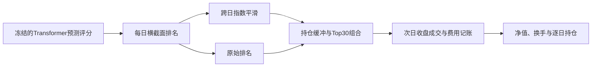

# SignalCraft

**把Transformer预测信号转化为换手更低的股票组合。**

每日按预测排名调仓，会让排名接近的股票反复进出组合。SignalCraft在冻结预测模型的基础上，开发排名指数平滑与持仓缓冲，并用同一套资金账本比较它们对换手和净收益的影响。

研究贡献集中在信号处理、组合构建与交易成本评估。基础预测模型采用[MASTER](https://github.com/SJTU-DMTai/MASTER)的官方CSI300开源数据权重；模型架构和预训练权重归原作者。

## 实验结果

历史沪深300成分股，2020年7月至2022年12月。信号在下一交易日收盘执行，持有30只股票，买入成本5bp、卖出成本15bp。

| 方案 | 年化净收益 | 日均单边换手 | 最大回撤 |
|---|---:|---:|---:|
| 原始信号 | 16.95% | 34.99% | -30.90% |
| 排名平滑 | 22.69% | 24.01% | -24.88% |
| 持仓缓冲 | 26.28% | 25.16% | -27.35% |
| 排名平滑＋持仓缓冲 | **24.54%** | **17.88%** | **-24.72%** |

组合方案相较原始策略，日均换手下降约49%，年化净收益增加7.59个百分点。单独使用持仓缓冲的净收益更高；四组结果均予以保留。

改善主要来自交易成本控制。零成本下，组合方案年化收益为36.29%，原始策略为39.53%；平滑也没有提高RankIC。完整费用敏感性结果见[对照表](results/comparison.csv)。

## 快速复算

需要Python3.11或更新版本。在仓库目录执行：

```bash
python -m venv .venv
# Windows: .venv\Scripts\activate
# macOS / Linux: source .venv/bin/activate
python -m pip install -r requirements-dev.txt
python -m pip install -e . --no-deps
python -m signalcraft.cli
python -m pytest
```

仓库提供本次研究的冻结预测输出及价格输入快照，运行回测无需GPU或API密钥。命令将重新计算四组方案与三种成本假设，在`output/`生成：

- `comparison.csv`：12组实验的汇总指标。
- `daily_*.csv`：每日净值、交易金额、成本、换手和冻结持仓数。
- `holdings_*.csv.gz`：基准成本下的逐日持仓权重。
- `input_hashes.json`：本次输入文件的校验值。

从原始预训练权重重新生成预测、从Qlib原始价格生成快照的方法见[完整复现流程](docs/reproduction.md)。

## 策略怎么工作



平滑采用`0.5×当前百分位＋0.5×前日平滑值`。持仓缓冲保留排名仍在前45的已有持仓，再按排名补足30只；冻结持仓占用资金和名额。参数固定，四组方案共用相同输入与交易规则。

## 阅读代码

| 文件 | 职责 |
|---|---|
| `signals.py` | 不依赖未来信息的排名平滑 |
| `backtest.py` | 选股、冻结持仓、费用后等权目标与资金守恒 |
| `metrics.py` | 从逐日账本计算绩效 |
| `inference.py` | 重新运行官方模型推断 |
| `tests/` | 次日成交、缓冲边界、费用、缺价和未来数据隔离 |

## 回测口径

这是日线交易成本研究。使用复权收盘价、分数股、零现金利息，以正成交量和绝对日涨跌幅小于9.5%作为简化成交约束。未模拟逐笔成交、市场冲击和各板块实际涨跌停规则。完整公式和讨论见[研究方法](docs/methodology.md)。

维护者：[Yixuan Sun](https://github.com/Sunyx0825)。数据来源、上游模型及引用见[data/README.md](data/README.md)。
